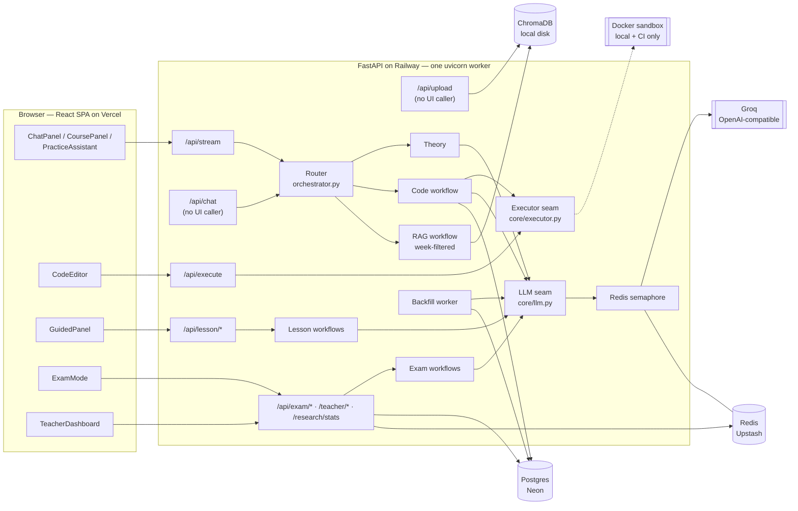
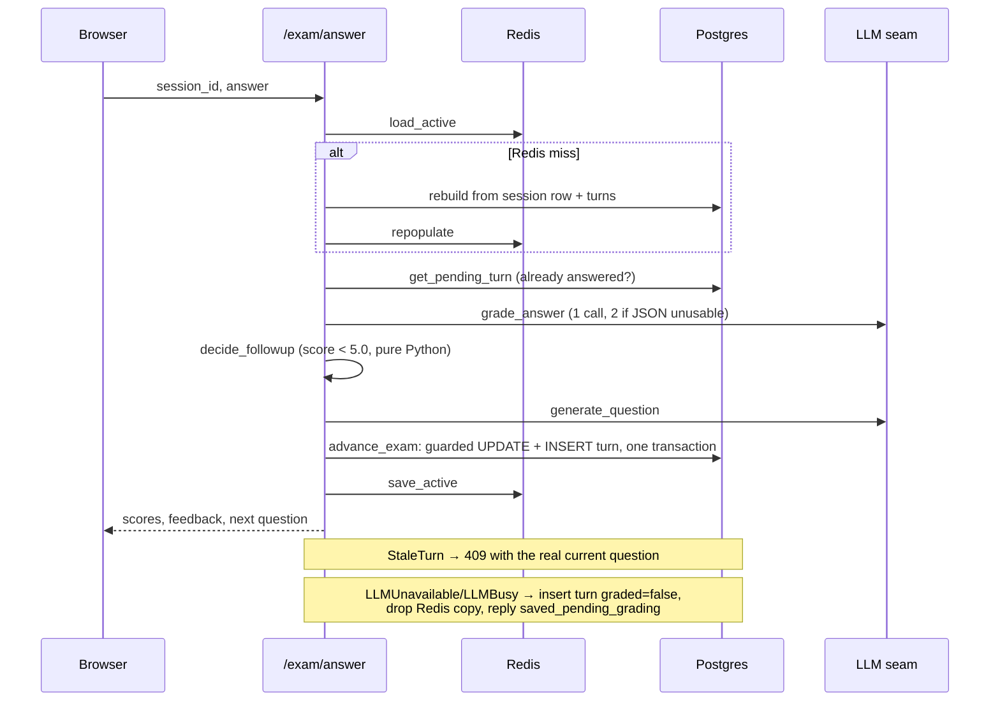

# QuantumMind, Explained

A study guide to this repository: what it is, how each request flows through it, what
every technology is doing and where, what's live, what's dead and what's broken.

Written against branch `docs/honest-readme` (commit `000f2a1`), which sits on
`fix/review-findings`, and updated for the fixes on `fix/pre-interview`; see
section 0. Where `main` differs, it says so. Citations are `file:line` at `000f2a1`.

**Contents**

0. [What changed on fix/pre-interview](#0-what-changed-on-fixpre-interview-read-this-first)
1. [Summary](#1-summary)
2. [Architecture and request paths](#2-architecture-and-request-paths)
3. [Technologies: what, where, why](#3-technologies-what-where-why)
4. [Inventory: used, local only, dead, missing](#4-inventory-used-local-only-dead-missing)
5. [Bug list](#5-bug-list)
6. [Five design decisions to defend](#6-five-design-decisions-to-defend)
7. [Twenty interview questions](#7-twenty-interview-questions)

---

## 0. What changed on `fix/pre-interview` (read this first)

Sections 1–7 were written against `docs/honest-readme` (commit `000f2a1`), and their
`file:line` citations point at that commit: run `git show 000f2a1:<path>` to read
exactly what they cite. The passages below whose *behaviour* changed have been
rewritten; everything else describes code that still works the same way.

| Item | What changed | Commit |
|---|---|---|
| Landing / mode copy | 36 students; no "Five AI agents", IBM Quantum, "instant AI review" or DeepMind/ETH comparison | `f61ee33` |
| Tailwind | v4 theme + utilities imported explicitly; spacing utilities were missing | `e8c4950` |
| Dead UI files, `sse-starlette` | Deleted | `c2cbd26` |
| B4a lesson grader | Fails closed; only JSON `true` passes | `de4f1b8` |
| A2 lesson answer key | Plan stored in Redis by `plan_id`; browser never sees `check_answer`; `/lesson/grade` takes `plan_id` + `step_num` + answer only | `64b89a4` |
| B5 prompt injection | Rubric in a system message; student text in escaped `<tags>` everywhere it enters a prompt | `6b27ae9` |
| A3 `/exam/start` | First question generated before any write; LLM outage → `503`, nothing stored | `7cda94b` |
| A4 ending early | Backfill also grades ungraded turns of ended sessions and refreshes their average | `7f1ea77` |
| A1 routing | One `WORKFLOW_FOR_LABEL` table for `/chat` and `/stream`; `review` → Code on both | `4951462` |
| A6 upload | Ingestion runs in `asyncio.to_thread` | `0780f94` |
| B1 leftover | Theory graph replays only the last 12 checkpointed messages | `8edb518` |
| B6 logging | JSON logs on stdout, `LOG_LEVEL`, request-id middleware; prints replaced; `llm_call` records now visible | `0dda819` |
| Structured output | Router, lesson-grade and exam-grade replies validated with Pydantic; one re-ask; fail closed | `e69460b` |
| RAG | `rag` label → RAG workflow on both paths, `week` passed through; shared, cached embedding model; retrieval off the loop; skips the model when empty | `20f3c98` |
| `shots` | Removed from `/execute` | `0e320ae` |
| B7 simulated streaming | Unchanged on purpose; still documented | — |

Still open from section 5: A5 (`/exam/end` takes a raw dict), A7 (memory depends on
the route), A8 (`str(e)` in error responses), A9 (no input caps or rate limit),
A10–A15, and B7.

---

## 1. Summary

QuantumMind is a quantum computing tutor: a React single-page app talking to a FastAPI
backend. The backend has one LLM router that labels a chat message (theory, code, rag,
review), plus five small LangGraph workflows: theory Q&A, Qiskit code generation,
guided lessons, adaptive exams with rubric grading, and a RAG workflow over uploaded
course notes (reached only when the router labels a question `rag`). Only the code workflow loops: it runs the generated code in a
locked-down Docker container and, if the run fails, gives the model one chance to fix
it. All control flow is fixed in Python, and no model picks tools or decides when to
stop, so these are **workflows, not agents**. The strongest engineering is in the
reliability layer around the model: one LLM seam with a provider switch, retries that
know what's worth retrying, a Redis concurrency limit shared by all workers, and an
exam path that stores every answer in Postgres before replying and grades it later
if the LLM is down. The weakest parts used to be a dead RAG path, a lesson grader that
failed open, student text pasted raw into prompts and logs that went nowhere; all
four are fixed on `fix/pre-interview` (section 0). What remains: simulated
streaming for Code and RAG, memory that depends on the route, no input caps or
rate limit, and injection that is mitigated rather than solved.
It's a prototype: the sandbox is switched off on the hosted deploy, and no real class
has used it.

---

## 2. Architecture and request paths

### 2.1 The whole system



Startup order matters. The lifespan in `backend/app/main.py:17-54` creates the
Postgres checkpointer first (`main.py:20`), because the graphs grab it when they are
first built. Then it pings Postgres (`main.py:25`) and Redis (`main.py:30`) and exits
if either is down, then starts the backfill worker (`main.py:41`). Shutdown runs in
reverse.

### 2.2 `POST /api/stream`: the path the UI actually uses for chat

Called by `ChatPanel.jsx:68` (theory and guided chat), `CoursePanel.jsx:43` (mode
`course`) and `PracticeAssistant.jsx:43` (mode `practice`).

1. **Validation.** Pydantic parses the body into `StreamRequest`
   (`backend/app/routes/stream.py:24-30`): `message` must be non-empty, `chat_history`
   at most 50 items of at most 8000 characters each, and `thread_id` defaults to a
   fresh UUID. `week` (0–13) is passed to the RAG workflow.
2. **Progress event.** The route returns a `StreamingResponse` wrapping an async
   generator (`stream.py:37-84`). Its first `yield` is a `progress` event, sent before
   any LLM work.
3. **Routing.** `stream_agent` (`backend/app/agents/orchestrator.py:127-160`): mode
   `practice` goes straight to the Code workflow; anything else goes to `route()`
   (`orchestrator.py:26-68`), one call on the router model that must return JSON
   such as `{"agent": "theory"}`. Bad JSON or an unknown name falls back to theory.
4. **Theory branch** (also taken for `rag` and `review`, `orchestrator.py:154`):
   `stream_theory_agent` (`backend/app/agents/theory_agent.py:91-114`) builds system
   prompt + the last 12 client-sent turns + the new message, then yields real tokens
   from `llm.stream()`. It skips the graph and the checkpointer.
5. **Code branch**: `stream_code_agent` (`backend/app/agents/code_agent.py:203-207`)
   runs the whole code graph, then splits the finished answer on spaces. The
   "streaming" is simulated.
5b. **RAG branch** (since `20f3c98`): `stream_rag_agent` runs the RAG graph with
   `week`, then sends the answer word by word, like Code.
6. Each piece is sent as `data: {"type": "token", ...}\n\n`, then a `done` event. Any
   exception becomes an `error` event carrying `str(e)` (`stream.py:69-71`).
7. **Browser side.** `EventSource` can't send a POST body, so the frontend uses
   `fetch` and reads `response.body.getReader()` (`ChatPanel.jsx:81`), splitting on
   lines that start with `data: ` (`ChatPanel.jsx:92`).

### 2.3 `POST /api/chat`: the non-streaming twin (no UI caller)

`backend/app/routes/chat.py:69-112`. It validates a `ChatRequest` (`chat.py:37-54`;
`thread_id` defaults to a fresh UUID at `chat.py:50`) and calls `run_agent`
(`orchestrator.py:71-124`). The differences from `/stream` are:

- Theory runs **through the graph** with the checkpointer (`theory_agent.py:73-84`),
  so memory comes from Postgres and the request's `chat_history` is ignored.
- `review` went to **Code** here (`orchestrator.py:118-121`) but to Theory on
  `/stream`. Since `4951462` both paths use one table and send it to Code.
- `agent_used` is always the string `"orchestrator"` (`chat.py:101`).

`GET /api/history/{thread_id}` (`chat.py:121-139`) reads the checkpoint for a thread
and returns its human and AI messages. It has no authentication.

On `main`, `ChatRequest` had no `thread_id`, so every `/chat` caller wrote to the
checkpoint thread `"default"` (bug B1 below).

### 2.4 `POST /api/execute`

Called by `CodeEditor.jsx:61`.

1. If `EXECUTOR=disabled`, answer **503** immediately (`backend/app/routes/execute.py:42-43`).
   This is the case on Railway.
2. Otherwise `executor.run_code(code, draw=True)` (`execute.py:45`). The seam
   (`backend/app/core/executor.py:103-119`) appends a drawing harness
   (`executor.py:50-71`) that finds the last `QuantumCircuit` in `locals()`, draws it
   with matplotlib and prints it as base64 between two markers.
3. A per-process `asyncio.Semaphore` caps concurrent runs (`executor.py:96-100`).
4. `_run_docker` (`executor.py:135-164`) runs `docker run --rm -i` with no network,
   memory and swap capped, CPU and PID caps, read-only root, `noexec` tmpfs, a
   non-root user, every capability dropped and `no-new-privileges`. The program goes
   in on stdin. A blocking `subprocess.run` runs in a thread (`executor.py:154`)
   because asyncio subprocesses need the Proactor loop on Windows, which psycopg
   can't use. On timeout, `docker kill` stops it from outside (`executor.py:156`).
5. The marker is parsed back out of stdout (`executor.py:81-90`); the route returns
   stdout, cleaned stderr, the image and the duration. The request's `shots` field
   (`execute.py:19`) is never used.

### 2.5 `/api/lesson/*`

Called by `GuidedPanel.jsx:112`, `:133`, `:153`. Each route calls one single-node graph
in `backend/app/agents/lesson_agent.py`.

- **`/lesson/plan`** (`backend/app/routes/lesson.py:25-32`): checks the in-memory LRU
  cache (`lesson_agent.py:92`), otherwise makes one LLM call for a JSON plan, parses it,
  caches it, and falls back to a hard-coded three-step plan on any parse error
  (`lesson_agent.py:103-110`). Since `64b89a4` the full plan is saved in Redis
  (`app/core/lesson_store.py`, key `lesson:{plan_id}`, TTL a day) and the response
  is the plan **without** any `check_answer`, plus `plan_id`.
- **`/lesson/teach`**: formats `STEP_PROMPT` with the step's fields (`lesson_agent.py:159-174`),
  makes one call, then rewrites deprecated Qiskit in code blocks (`sanitize_content`,
  `lesson_agent.py:35-46`). `step` is an untyped `dict` (`lesson.py:15`), so a step
  missing `title` gives a 500.
- **`/lesson/grade`**: the browser sends only `plan_id`, `step_num` and
  `student_answer`; any extra field, `correct_answer` included, is a 422. The route
  loads the stored plan (404 if expired), takes that step's question and key, and
  grades. The reply must validate as `LessonGrade` (`passed` a real boolean); one
  re-ask, then it **fails closed** with `passed: false`. (On `000f2a1` the browser
  sent the key itself and an unreadable reply counted as a pass.)

### 2.6 `/api/exam/*`: the most carefully engineered path

Called by `ExamMode.jsx` (`:135` start, `:160` answer, `:85` status poll, `:406` end)
and `TeacherDashboard.jsx`.

**Start** (`backend/app/routes/exam.py`): since `7cda94b`, generate question 1 first
(V1 takes it from a static bank, `backend/app/agents/exam_agent.py:133-137`). If the
LLM is down that's a 503 and **nothing is written**. Otherwise one INSERT creates
the session already holding its first question, *then* the hot copy goes to Redis.
(On `000f2a1` the row was created first, so an outage left an empty active session.)

**Answer** (`exam.py:103-255`):



- Loading state: `load_active` (`backend/app/core/exam_state.py:38-91`) reads Redis,
  or rebuilds the whole state from Postgres on a miss.
- Idempotency: if an answered turn is already parked at the current position, the
  route returns the pending state instead of grading again (`exam.py:112-114`).
- Grading: `grade_answer_node` (`exam_agent.py:267-306`) parses the reply with
  `parse_grade` (`exam_agent.py:229-264`). That tolerates code fences, clamps scores
  to 0–10 and rejects anything non-numeric. If the reply is unusable it re-asks once,
  showing the model its own reply (`exam_agent.py:283-289`), then raises
  `GradingFailed` (`exam_agent.py:292`). The route records that answer with **no
  scores** (`exam.py:128-129`).
- Follow-up: `should_generate_followup` (`exam_agent.py:333-370`) is plain Python. V1
  never follows up, V2 at most once, V3 at most twice, never past turn 10.
- Writing: `advance_exam` (`backend/app/db/audit_db.py:345-391`) runs
  `UPDATE exam_sessions ... WHERE current_turn_number = :answered_turn AND status = 'active'`
  first, which takes the row lock. Only if exactly one row changed does it insert the
  turn (`audit_db.py:331-342`). A concurrent duplicate submit blocks on the lock,
  re-reads, matches nothing and raises `StaleTurn`, which becomes a 409
  (`exam.py:235-237`). A unique `(session_id, turn_number)` constraint is the backstop
  (`backend/app/db/models.py:72`).
- Degraded path: on `LLMUnavailable` or `LLMBusy` the answer is inserted with
  `graded=false` (`exam.py:239-255`).

**Status** (`exam.py:280-297`): the browser polls every 4 s (`ExamMode.jsx:101`) until
`awaiting_grade` turns false.

**Backfill worker** (`backend/app/core/grading_backfill.py`): one asyncio task per
process (`grading_backfill.py:134-138`). Every 15 s it fetches stuck turns
(`audit_db.get_pending_turns`) and runs `reconcile_session` (`grading_backfill.py:36-111`):
grade if ungraded, with `finalize_grade` claiming the turn through
`UPDATE ... WHERE graded = false` (`audit_db.py:192`), then advance with
`advance_in_flight_if` (`grading_backfill.py:92`), which only moves a session still
parked at the expected turn. Since `7f1ea77` each sweep also grades ungraded turns
of sessions that already ended (grade only, no advance) and refreshes that
session's `avg_score`.

**End** (`exam.py:258-268`): computes the average over graded turns, marks the session
completed, drops the Redis copy.

**Teacher endpoints** (`exam.py:356-406`): password-checked with `verify_teacher`
(`backend/app/core/auth.py:14-29`, a constant-time compare). Reviews are append-only
and copy the AI's scores from the stored turn, never from the request
(`audit_db.py:449-513`).

### 2.7 `POST /api/upload` (teacher only, no UI caller)

`backend/app/routes/upload.py:65-155`. The `require_teacher` dependency checks the
header, the extension must be `.pdf/.ipynb/.py/.md`, and the read is capped at 20 MB
(`upload.py:97-102`). The file goes to a temp file and is loaded (PyPDF, notebook JSON
cells, or plain text), split into 800-character chunks with 100 overlap, and tagged
with `week`. The chunks are embedded with `all-MiniLM-L6-v2` and added to Chroma
(`upload.py:135-136`), and the temp file is deleted in `finally`. Since `0780f94` the
parse, embed and write run in `asyncio.to_thread(ingest_file, ...)`, and since
`20f3c98` the vector store and a once-per-process embedding model come from
`app/core/vectorstore.py`, which the RAG workflow reads too.

---

## 3. Technologies: what, where, why

### Backend

**FastAPI.** A Python web framework that builds routes from type-hinted functions and
runs on an async server (uvicorn). It validates requests with Pydantic and generates
OpenAPI docs.
*Here:* app and lifespan in `backend/app/main.py:57-64`; one `APIRouter` per file, all
mounted under `/api` (`main.py:98-103`). `/docs` only exists when
`APP_ENV=development` (`main.py:62`). The single CORS config is at `main.py:71-78`.
Dependencies (`Depends`) appear once, for teacher auth on upload (`upload.py:65`).

**Pydantic and pydantic-settings.** Pydantic turns dicts into typed, validated objects;
pydantic-settings does the same for environment variables and `.env`.
*Here:* request models such as `StreamRequest` (`stream.py:24-30`) and `ReviewRequest`
with `ge=0, le=10` bounds (`exam.py:370-380`). `Settings` (`backend/app/core/config.py:21-181`)
has three fail-fast validators: provider config (`config.py:125`), the executor gate
that forbids `subprocess` in production (`config.py:142`), and refusing the published
teacher password in production (`config.py:161`). `extra = "forbid"` (`config.py:176`)
makes a misspelled `.env` key crash at startup.

**SSE (Server-Sent Events).** A one-way HTTP stream of `data: ...\n\n` lines from
server to browser.
*Here:* `StreamingResponse` with `media_type="text/event-stream"`
(`stream.py:73-84`); the helper that formats an event is at `stream.py:33-34`.
`X-Accel-Buffering: no` stops proxies from buffering it. The browser reads the stream
with `fetch`, not `EventSource`, because the request is a POST. `sse-starlette` is in
`pyproject.toml` but never imported.

**LangGraph.** A library for writing LLM programs as graphs: a typed **state** dict,
**nodes** (functions that return a partial state update), **edges** (fixed next step),
**conditional edges** (a function on the state picks the next node), and an optional
**checkpointer** that saves state per `thread_id`.
*Here, using the code workflow as the example:*
- State: `CodeAgentState` (`code_agent.py:20-29`). `messages: Annotated[list, operator.add]`
  is a **reducer**: when a node returns `{"messages": [x]}`, LangGraph appends `x`
  instead of replacing the list. That's what lets the checkpointer accumulate a
  conversation across calls. Fields without a reducer are overwritten.
- Nodes: `generate`, `execute_code`, `increment_retry`, `assemble` (`code_agent.py:171-174`).
- Edges and the conditional edge: `code_agent.py:175-179`; `should_retry`
  (`code_agent.py:161-166`) returns `"retry"` or `"done"`.
- Compile with a checkpointer: `code_agent.py:180`. Invoke with
  `config={"configurable": {"thread_id": ...}}` (`code_agent.py:198-199`).
- Checkpointer: `AsyncPostgresSaver` over a psycopg pool (`backend/app/core/memory.py:34-52`);
  `setup()` creates its tables.
- The other seven graphs are one node each (theory, three lesson graphs, two exam
  graphs) or the dead RAG graph (`backend/app/agents/rag_agent.py:210-232`). Lesson and
  exam graphs compile without a checkpointer because their state lives in the request
  or in Postgres.

**LangChain.** A toolkit of LLM building blocks: message classes, model clients, output
parsers, loaders, splitters and vector store wrappers.
*Here:* `SystemMessage/HumanMessage/AIMessage` in every workflow; `ChatOpenAI` built
only in the seam (`backend/app/core/llm.py:90-105`); `StrOutputParser` (`llm.py:256`);
`PyPDFLoader`, `RecursiveCharacterTextSplitter`, `Chroma` and `HuggingFaceEmbeddings`
in `upload.py:15-18` and `rag_agent.py:15-16`.

**Groq / OpenAI / vLLM through one client.** All three serve the OpenAI
chat-completions API, so one client class can talk to any of them.
*Here:* `_PROVIDER_BASE_URLS` (`llm.py:56-60`) and `_resolve_api_key` (`llm.py:69-75`)
are the only provider-specific code. Per-call-type temperatures live in one table
(`llm.py:41-52`). `tests/test_llm_provider_switch.py` checks each provider's URL and
key and that bad config fails at startup. `tests/test_llm_seam_isolation.py` walks the
AST of every module and fails if anything outside `llm.py` imports an LLM SDK.

**tenacity.** A retry library: stop conditions, wait strategies, and which exceptions
to retry.
*Here:* `_run_resilient` (`llm.py:141-166`) uses `AsyncRetrying` with
`stop_after_attempt(4)`, `wait_exponential_jitter`, and `retry_if_exception(_is_transient)`.
`_is_transient` (`llm.py:113-131`) treats timeouts, connection errors, 408/409/429 and
5xx as retryable and everything else as a bug. The SDK's own retries are off
(`llm.py:102`), so retries don't multiply. Streams can't use tenacity cleanly; the
manual loop in `stream()` retries only before the first token (`llm.py:300-302`).

**Redis.** An in-memory data store with atomic commands and server-side Lua scripts.
The repo uses it three ways:
1. *Concurrency semaphore:* a sorted set `llm:inflight`. `_ACQUIRE_LUA`
   (`backend/app/core/llm_limiter.py:41-49`) prunes stale tokens, adds this one,
   counts with `ZCARD`, and removes it again if over the limit, all atomically. It's
   called at `llm_limiter.py:67` and polled with jitter until `LLMBusy`
   (`llm_limiter.py:76`). If Redis is down it **fails open** (`llm_limiter.py:68-70`).
   Every `chat()` and `stream()` holds a slot (`llm.py:244`, `llm.py:285`).
2. *Exam hot copy:* `exam:{session_id}` JSON with a TTL (`exam_state.py:26-30`).
3. *Counters:* `INCRBY llm:tokens:total:<day>` and `INCR llm:calls:<day>`
   (`llm.py:171-187`).
The client is created once per process (`backend/app/db/redis_client.py:16-23`).

**Postgres + SQLAlchemy 2 async + psycopg 3.** Postgres is the source of truth.
SQLAlchemy's async engine pools connections; psycopg 3 is the driver for both async
and sync use.
*Here:* engine at `backend/app/db/database.py:23-33` (`pool_pre_ping=True`). Models
(`backend/app/db/models.py`): `exam_sessions` with the in-flight question columns
(`models.py:56-59`), `exam_turns` with `graded` and the unique constraint,
`teacher_reviews`, and an unused `research_metrics`. Every write in
`backend/app/db/audit_db.py` is a conditional `UPDATE` whose `rowcount` says whether
this caller won.

**Alembic.** Versioned schema migrations for SQLAlchemy.
*Here:* `backend/alembic/versions/0001_initial_schema.py`, `0002_exam_turns_graded.py`
and `0003_exam_turns_unique_turn.py`. Railway runs `alembic upgrade head` as a
pre-deploy step (`backend/railway.toml:24`), so a failed migration stops the deploy
instead of crash-looping. The integration tests also run `upgrade head`
(`backend/tests/integration/conftest.py:78-82`), so CI exercises the migrations.

**ChromaDB + sentence-transformers.** A local vector database, plus a small embedding
model (all-MiniLM-L6-v2, CPU) that turns text into vectors.
*Here:* written by `/upload` (`upload.py:56-62`, `:135-136`) and read only by the dead
RAG graph (`rag_agent.py:29-39`, `:76-92`). Torch is pinned to the CPU wheel index
(`backend/pyproject.toml`) to keep the image small. On Railway the disk is wiped on
every redeploy.

**Docker sandbox.** One throwaway container per code run.
*Here:* flags at `executor.py:137-151`, image in `sandbox/Dockerfile` (Qiskit, Aer and
matplotlib only, non-root). Seven containment tests in
`backend/tests/sandbox/test_containment.py` prove that a normal circuit runs and that
the network, secrets, filesystem, infinite loops, memory bombs and fork bombs are
contained. Off on Railway: no Docker daemon there.

**Qiskit / Aer.** IBM's quantum SDK and its local simulator.
*Here:* the code the students and the LLM write. The prompts force the modern API
(`code_agent.py:55-68`), and `fix_deprecated` rewrites old calls by string
replacement (`code_agent.py:212-231`). It runs inside the sandbox image. It's also a
backend dependency, used only by the insecure `subprocess` executor in development.

### Frontend

**React 19.** A UI library: components are functions that return JSX, re-rendered when
state changes.
*Here:* routes in `frontend/src/App.jsx:10-16` (React Router 7: `/`, `/select`, `/app`,
`/teacher`). `MainApp.jsx` picks the panel for the mode. Each panel keeps its own
`useState` and calls `fetch` directly; there is no API client layer beyond `API_BASE`
(`frontend/src/lib/api.js:10`). Global UI state is a small Zustand store
(`frontend/src/hooks/useAppState.js:16`). Monaco provides the editor
(`CodeEditor.jsx:2`), and the browser's Web Speech API provides voice input for exams
(`ExamMode.jsx:107`).

**Tailwind CSS.** Utility CSS classes (`flex`, `px-4`) generated at build time.
*Here:* barely used. The components style almost everything with inline `style={{}}`
objects; only about 7 `className` utility strings exist in `src/components`.
`globals.css:9-11` uses the v3 `@tailwind` directives while `package.json` pins
Tailwind 4, which expects `@import "tailwindcss"`. Check in a browser whether any
utilities are generated before claiming Tailwind in an interview.

**Vite.** A dev server and bundler.
*Here:* `frontend/vite.config.js` sets the `@` → `src` alias. `VITE_API_URL` is
inlined at build time (`api.js:10`), so the deployed bundle has the backend URL baked
in.

### Hosting and CI

**Railway.** Hosts containers built from a Dockerfile.
*Here:* `backend/railway.toml`: Dockerfile build, pre-deploy migrations, `/health`
check, restart on failure up to 10 times. `backend/Dockerfile` runs exactly **one**
uvicorn worker (`Dockerfile:70`) and explains why: the lesson cache and the executor
semaphore are per process.

**Vercel.** Hosts static sites.
*Here:* `frontend/vercel.json` builds with Vite and rewrites every path to
`index.html` so React Router can handle deep links.

**GitHub Actions.** CI.
*Here:* `.github/workflows/ci.yml`. The `test` job starts `postgres:16` and `redis:7`
as service containers, builds the sandbox image, sets `REQUIRE_INTEGRATION=1` and
`REQUIRE_SANDBOX=1` (a missing service fails the run instead of skipping), and runs
the whole suite. The `frontend` job only runs `npm run build`; there are no frontend
tests.

---

## 4. Inventory: used, local only, dead, missing

Legend: **USED** = wired in and reachable on the hosted deploy · **API ONLY** =
reachable over HTTP but nothing in the UI calls it · **LOCAL** = works locally and in
CI, off on Railway · **DEAD** = nothing calls it · **MISSING** = claimed but not in the
code.

### Backend

| File | What it does | Status | Tested |
|---|---|---|---|
| `app/main.py` | App, lifespan, CORS, router mounting | USED | Indirectly (`test_http_contracts.py` uses `TestClient` without the lifespan) |
| `routes/stream.py` `/stream` | SSE chat | USED | `test_stream_history.py` |
| `routes/stream.py` `/cache/stats` | Lesson-cache stats | API ONLY | No |
| `routes/stream.py:30` `week` | Accepted, passed on, ignored | DEAD | — |
| `routes/chat.py` `/chat`, `/history`, `/chat/health` | Non-streaming chat, checkpoint replay | API ONLY | `test_chat_routes.py` |
| `routes/execute.py` | Run Qiskit in the sandbox | LOCAL (503 on Railway) | 503 contract; sandbox tier |
| `routes/execute.py:19` `shots` | Validated, never used | DEAD | — |
| `routes/lesson.py` | Plan, teach, grade | USED | **No** |
| `routes/exam.py` student routes | Start, answer, status, end | USED | Integration tier |
| `routes/exam.py:271` `/exam/session/{id}` | Teacher transcript | API ONLY | Auth only |
| `routes/exam.py` teacher/research routes | Dashboard, reviews, stats | USED | Integration + auth |
| `routes/upload.py` | Ingest into Chroma | API ONLY; its output is DEAD | Auth + size cap only |
| `agents/orchestrator.py` | LLM router | USED; `rag`/`review` branches fall back | Parse + fallback |
| `agents/theory_agent.py` stream path | Real token streaming | USED | Yes |
| `agents/theory_agent.py` graph path | Checkpointed theory | API ONLY (via `/chat`) | Smoke |
| `agents/code_agent.py` | Generate → execute → repair once | USED; execution LOCAL | `test_code_agent.py`, checkpointer integration |
| `agents/rag_agent.py` | Retrieve → generate → judge | DEAD | No |
| `agents/lesson_agent.py` | Three single-prompt graphs | USED | **No** |
| `agents/exam_agent.py` | Questions, grader, follow-up rule | USED | Yes |
| `core/llm.py` | The LLM seam | USED | Yes, heavily |
| `core/llm.py:198` per-call log record | `logger.info` with no handler | Emitted but dropped | Only via pytest `caplog` |
| `core/llm_errors.py` | Typed errors | USED | Yes |
| `core/llm_limiter.py` | Redis Lua semaphore | USED | Unit (fail-open) + integration (burst) |
| `core/grading_backfill.py` | Grade and advance stuck turns | USED | Integration |
| `core/executor.py` `docker` backend | Sandbox | LOCAL | Sandbox tier |
| `core/executor.py` `disabled` branch | Refuse to run | USED on Railway | Yes |
| `core/executor.py` `subprocess` backend | Host execution, dev only | LOCAL (dev) | Gate tests |
| `core/exam_state.py` | Redis copy + Postgres rebuild | USED | Integration |
| `core/memory.py` | Postgres checkpointer | USED | Integration |
| `core/cache.py` | Lesson-plan LRU | USED (lesson plans only) | No |
| `core/auth.py` | Teacher password check | USED | Yes |
| `core/config.py` | Settings + validators | USED | Yes |
| `core/prompts.py` `ORCHESTRATOR_PROMPT` | Router prompt | USED | Indirectly |
| `core/prompts.py` `RAG_PROMPT`, `build_rag_prompt` | Only the RAG graph uses them | DEAD | — |
| `db/models.py` `ResearchMetric` | Table nothing writes | DEAD | — |
| `db/models.py` other models | Schema | USED | Integration |
| `db/audit_db.py` | Repository with guarded writes | USED | Integration |
| `db/database.py`, `db/redis_client.py` | Pools | USED | Integration |
| `alembic/versions/0001–0003` | Migrations | USED (pre-deploy) | CI runs `upgrade head` |
| `sandbox/Dockerfile` | Sandbox image | LOCAL | Sandbox tier |
| `Dockerfile`, `railway.toml` | Prod image and deploy | USED | Not in CI |
| `pyproject.toml` `sse-starlette` | Declared, never imported | DEAD (removed in `c2cbd26`) | — |
| `pyproject.toml` `python-dotenv` | Not imported by app code, but pydantic-settings uses it to read `.env` | Redundant direct pin, not dead | — |

On `main` there are two more DEAD items, both removed on this branch: `cached_ideal`
in the exam grader (`main:backend/app/agents/exam_agent.py:208`, computed and never
used), and unused prompts in `prompts.py` (removed in `0681ae5`).

### Frontend

| File | What it does | Status |
|---|---|---|
| `main.jsx`, `App.jsx` | Entry, routes | USED |
| `LandingPage.jsx` | Marketing page | USED, but its copy overclaims (see MISSING) |
| `ModeSelector.jsx` | Pick a mode | USED, copy overclaims |
| `MainApp.jsx`, `Sidebar.jsx`, `CourseSidebar.jsx` | Layout | USED |
| `ChatPanel.jsx` | Theory/guided chat → `/stream` | USED |
| `CoursePanel.jsx` | Course chat → `/stream` mode `course` (answers via Theory) | USED |
| `PracticeAssistant.jsx` | Practice chat → `/stream` mode `practice` (Code workflow) | USED |
| `CodeEditor.jsx` | Monaco + Run → `/execute` | USED; gets 503 on Railway |
| `GuidedPanel.jsx` | Lessons → `/lesson/*` | USED |
| `ExamMode.jsx` | Exams → `/exam/*`, voice input, status polling | USED |
| `TeacherDashboard.jsx` | Sessions, reviews, stats | USED |
| `ui/Badge.jsx` | Badge | USED |
| `ui/Button.jsx` | Button | DEAD (not imported) |
| `SplashScreen.jsx` | Splash | DEAD (not imported) |
| `components/_unused/*` (9 files) | Parked components | DEAD |
| `hooks/useAppState.js`, `data/curriculum.js`, `lib/api.js`, `lib/chat.js` | Store, course tree, API base, history helper | USED |

No frontend tests exist.

### Claimed but missing

| Claim | Where | Reality |
|---|---|---|
| "The Seven Agents" | `main:README.md:340` | A router plus five workflow modules (eight graphs); one is dead |
| A Review agent | `main:README.md`; router prompt `backend/app/core/prompts.py:26`; "get instant AI review" `ModeSelector.jsx:21` | No review code. `review` runs Code on `/chat` and Theory on `/stream` |
| Theory answers cached in an LRU, "~3s → ~50ms" | `main:README.md:185`, `:343`, `:351` | The theory workflow has never used the cache; only lesson plans do |
| "60+ students" | `main:README.md:44`, `:62`, `:827`; `LandingPage.jsx:8`, `:18` | 36 students |
| "Five AI agents" | `LandingPage.jsx:138` | See the first row |
| "Run on IBM Quantum simulators" | `ModeSelector.jsx:21` | Local Aer in a container, and not at all when hosted |
| "RAG-powered AI tutor" | `ModeSelector.jsx:41-42`, `LandingPage.jsx:200` | RAG never runs |
| "Mirrors production AI systems at Google DeepMind, IBM Research, ETH Zurich" | `LandingPage.jsx:194` | Unsupported comparison |
| "Exam Mode — Soon" | `LandingPage.jsx:19` | Understated: exam mode exists |
| sse-starlette for streaming | README tech table (fixed now) | `StreamingResponse` |
| "Logs one structured JSON record" per call | README Accounting (qualified now) | Emitted, dropped (B6) |
| "Every agent graph compiles and runs" | `main:README.md:564` | The RAG and lesson graphs have no tests |

---

## 5. Bug list

Status is given for both branches. **Fixed** means fixed on `fix/review-findings` and
not yet on `main` or in the deploy. Items fixed later on `fix/pre-interview` are
listed in section 0; the evidence below cites the code before those fixes.

### The bugs you asked about

| # | Claim | Verdict | Evidence | One-line fix |
|---|---|---|---|---|
| B1 | `/chat` never passes `thread_id`, so everyone shares checkpoint thread `"default"` | **Confirmed on `main`; fixed here** (`b8c892e`). The UI never calls `/chat`, so no student was affected. | `main`: `ChatRequest` has no `thread_id` (`main:backend/app/routes/chat.py:35-45`); `run_agent` defaults to `"default"` (`main:backend/app/agents/orchestrator.py:75`). Here: `chat.py:50` defaults to a fresh UUID; test `test_chat_routes.py:30`. **Still open:** the theory graph sends the *whole* checkpointed history with no cap (`theory_agent.py:50`), so a reused thread grows without bound. | Slice `state["messages"][-MAX_HISTORY_MESSAGES:]` as the code workflow does (`code_agent.py:89`). |
| B2 | Code workflow appends the user message twice | **Confirmed on `main`; fixed here** | `main:backend/app/agents/code_agent.py:80` uses `state["messages"]` (already ending in the new message), then `:94` appends it again. Here: `code_agent.py:89`; test `test_code_agent.py:51`. | — |
| B3 | With `EXECUTOR=disabled` the code workflow still retries and wastes a call | **Confirmed on `main`; fixed here** (`ce4e0cb`) | `main:backend/app/agents/code_agent.py:148` retries on any error. Here: `execution_unavailable` (`code_agent.py:131-135`) short-circuits `should_retry` (`:162-163`); test `test_code_agent.py:36`. | — |
| B4a | Lesson grading fails open on a JSON parse error | **Confirmed, both branches** | Bare `except:` returns `passed: True` (`lesson_agent.py:232-233`). | Return `passed: False` with "couldn't grade, try again", and catch `ValueError` only. |
| B4b | Exam parse failure returns 5.0, exactly the threshold | **Confirmed on `main`; fixed here** (`50d45dd`) | `main:backend/app/agents/exam_agent.py:223-225` default each missing score to 5.0, and `:236` sets all four to 5.0 on any exception. `total < 5.0` is then false, so a failed grade means "no follow-up" and looks like a borderline pass. Here: one corrective retry, then `GradingFailed` (`exam_agent.py:283-292`) and the turn is stored with NULL scores (`exam.py:128-129`). | — |
| B5 | Student answers go raw into grading prompts (prompt injection) | **Confirmed, both branches** | Exam grader `exam_agent.py:273-277`, lesson grader `lesson_agent.py:219-223`, and previous answers in the question prompt `exam_agent.py:141`. Everything goes into one `HumanMessage` with the instructions. Clamping (`exam_agent.py:258`) limits the damage to "any score from 0 to 10". | Put the rubric in a system message and the answer in its own message inside delimiters, escaping the closing delimiter; send low-confidence or extreme grades to teacher review. |
| B6 | `print()` logging with no logging config, so `logger.info` accounting is dropped | **Confirmed, both branches** | No `basicConfig` or `dictConfig` anywhere in `backend/app`. Records at `llm.py:198`, `grading_backfill.py:111` and `:138` are INFO. The root logger defaults to WARNING, and uvicorn configures only its own loggers. 59 `print()` calls carry everything else. | Call `logging.basicConfig(level=logging.INFO, format="%(message)s")` at import in `main.py`, then replace the prints. |
| B7 | Code-workflow "streaming" is fake | **Confirmed, both branches** | `code_agent.py:203-207` awaits the full graph, then yields `response.split(" ")`. Same pattern in the dead `rag_agent.py:268-277`. | Stream the `generate` node's tokens with `graph.astream(..., stream_mode="messages")`, or send the answer as one honest chunk. |

### Other bugs found

| # | Bug | Evidence | One-line fix |
|---|---|---|---|
| A1 | `review` routes differently on the two paths: Code on `/chat`, Theory on `/stream` | `orchestrator.py:118-121` vs `:154` | One routing table used by both functions. |
| A2 | The lesson answer key travels through the browser; a student can read it, or replace it to pass | Plan returns `check_answer`; grade takes `correct_answer` from the request (`lesson.py:21`, `GuidedPanel.jsx:158`) | Store the plan server-side and grade by `(plan_id, step)`. |
| A3 | `/exam/start` isn't covered by the degradation path: an LLM outage gives a 500 after the session row exists, leaving an empty "active" session | `exam.py:38` creates the row before the LLM call at `:40` | Generate the question first, or mark the session abandoned in an `except`. |
| A4 | Ending an exam with an answer still pending strands it: the session becomes `completed`, and the backfill only reconciles active sessions | `exam.py:259-268`; `grading_backfill.py:39-40` | Finalize pending turns before ending, or let the backfill grade turns of ended sessions. |
| A5 | `/exam/end` takes a raw `dict`, so there's no validation | `exam.py:259` | A Pydantic `EndRequest`. |
| A6 | Upload embedding blocks the event loop | Synchronous `add_documents` inside `async def` (`upload.py:135-136`) | `await asyncio.to_thread(vectorstore.add_documents, chunks)`. |
| A7 | Memory depends on the route: streamed Theory uses client history and Code uses its checkpoint, so a conversation that switches loses context | `theory_agent.py:91-110` vs `code_agent.py:89` | Pick one memory source, the checkpointer, for both. |
| A8 | Errors leak `str(e)` to clients, contradicting the comment that says they don't | `chat.py:104-112`, `stream.py:71`, `lesson.py` 500s, `upload.py` | Log the exception; return a generic message. |
| A9 | No length caps on exam answers or chat messages; `/stream` is public | `exam.py:71`, `stream.py:26` | `max_length` on both, plus a per-IP rate limit. |
| A10 | A reply without a code fence is executed whole as code | `extract_code_block` returns all the text (`code_agent.py:233-235`) | Treat "no code block" as a generation error and skip execution. |
| A11 | `.lstrip("```json")` strips a *set of characters*, not a prefix | `lesson_agent.py:102` | Reuse `parse_grade`'s fence-stripping regex. |
| A12 | The concurrency slot is held through tenacity's backoff sleeps, so an outage ties up slots and makes `LLMBusy` more likely | `llm.py:244-245` wraps all retries | Acquire the slot inside each attempt. |
| A13 | Research stats count every review row, while transcripts show only the latest review per turn | `audit_db.py:646-653` vs `:572-602` | Use the same `row_number()` filter in the stats query. |
| A14 | `/history/{thread_id}` has no auth: anyone with a thread id can read that conversation | `chat.py:121` | Bind threads to a session or user. |
| A15 | `agent_used` is always `"orchestrator"` | `chat.py:101` | Return the routed name from `run_agent`. |
| A16 | The `railway.toml` comment says the first boot downloads the embedding model; it's loaded on the first upload | `railway.toml:34-36` vs `upload.py:38-43` | Fix the comment and lower the health-check timeout. |

---

## 6. Five design decisions to defend

**1. One LLM seam, and one OpenAI-compatible client for every provider.**
Every model call goes through `llm.chat()` or `llm.stream()`, and a test fails the
build if any other module imports an LLM SDK.
*Gain:* timeouts, retries, concurrency limits and accounting live in one place, so no
workflow can skip them. Moving from Groq to self-hosted vLLM is a config change, and
the dev and prod paths are the same code.
*Cost:* only features common to the OpenAI API are available, so no provider-specific
tool formats or caching knobs. And a fresh `ChatOpenAI` is built per call, which is
cheap but not free.

**2. Workflows with code-owned control flow, not autonomous agents.**
The model labels, generates and grades; Python decides what runs next.
*Gain:* predictable cost (at most two calls on any path except RAG), unit-testable
branches (the follow-up rule needs no model at all), and an exam a teacher can
explain to a student. An 8B model is unreliable at choosing tools, so this plays to
its strengths.
*Cost:* it can't handle a request the graph didn't anticipate, a misrouted message
goes to the wrong workflow with no recovery, and calling it "multi-agent" overstates
it. Say "workflows" in the interview.

**3. Postgres is the truth; Redis is a cache you can throw away.**
Every exam write goes to Postgres first, then Redis. A Redis miss rebuilds the state
from Postgres.
*Gain:* a restart or a Redis flush mid-exam loses nothing (there's a test for it),
and any worker can serve any session.
*Cost:* two writes per answer, and a window where Redis is stale. That window is why
every write is a guarded `UPDATE ... WHERE current_turn_number = :expected`, and why
a stale copy gets a 409 and is dropped.

**4. Save the answer now, grade it later, with idempotency enforced in the database.**
When the LLM is down, the answer is inserted with `graded=false` and the student is
told it's saved. A background worker grades it when the LLM is back.
*Gain:* no student loses an answer to a 429, and the writes are safe to repeat
because conditional `UPDATE`s and a unique constraint decide the winner. That needs
no locks, queues or leader election.
*Cost:* the *work* isn't idempotent, so two workers can both pay for the same grading
call. The student waits up to a 15 s sweep plus 4 s polling. And the guarantee
covers `/exam/start` (A3) and ending early (A4) only since `7cda94b` and `7f1ea77`.

**5. A throwaway container per run, behind an executor seam with a `disabled` mode.**
*Gain:* strong, testable containment (no network, no env, read-only root, caps, non-root,
no capabilities), and the code that calls it doesn't care which backend is active.
`disabled` gives an honest 503 instead of a misleading "your code failed".
*Cost:* the API needs the Docker socket, which is root-equivalent on that host. The
kernel is shared (no gVisor or VM). Each run pays container start-up time. And the
host must have a Docker daemon, which is exactly why Practice is off on Railway.

---

## 7. Twenty interview questions

**1. Is QuantumMind agentic?**
Not in the strict sense. It's an LLM router plus fixed LangGraph workflows. The only
loop is in the code path: run the code, and on failure feed the traceback back once.
Python decides that loop, not the model. I chose that because an 8B model is
unreliable at picking tools, and an exam needs reproducible behaviour.

**2. Walk me through a chat message.**
POST `/api/stream`, Pydantic validates it, a `progress` event goes out, then one
router call labels the message. Theory streams real tokens from the seam with the
last 12 client turns. Code runs the whole graph, then sends the answer word by word.
The browser reads it with `fetch` and a stream reader, because `EventSource` can't
POST.

**3. What does the LangGraph checkpointer give you, and why does streamed theory skip it?**
It saves graph state per `thread_id` in Postgres, so the code workflow remembers a
conversation across requests and restarts. Theory streams straight from the seam
outside the graph, so it uses client-sent history instead. The honest cost is that
the two paths remember different things (A7).

**4. What does `Annotated[list, operator.add]` do in the state?**
It's a reducer. When a node returns `{"messages": [m]}`, LangGraph appends `m`
instead of replacing the list. Combined with the checkpointer, that's what
accumulates a conversation. On `main`, the code node also appended the new message
itself, so the model saw it twice (B2).

**5. How do you stop two submits from recording the same answer twice?**
In the database. `advance_exam` first runs an `UPDATE` that only matches if the
session is still at the answered turn. That takes the row lock, so a concurrent
duplicate waits, then matches zero rows and gets a 409. A unique
`(session_id, turn_number)` constraint backs it up for every write path.

**6. Redis dies mid-exam. What happens?**
The hot copy is gone, so the next request misses, rebuilds the state from the session
row plus its turns in Postgres, writes it back to Redis and continues. The LLM limiter
fails open in the meantime. Both are covered by tests.

**7. The LLM is down when a student submits. What happens?**
After the retries are used up, the seam raises `LLMUnavailable`. The route inserts
the turn with `graded=false`, drops the Redis copy and returns `saved_pending_grading`.
The browser polls `/status`. Every 15 s the backfill worker grades the turn, claims
it with `UPDATE ... WHERE graded = false`, and advances the session with a guarded
update.

**8. Why a Lua script for the semaphore?**
Prune, claim, count and give-back must be atomic, or two workers can both see room
and over-admit. Redis runs a Lua script as one atomic step. A `MULTI` transaction
can't branch on the count in the middle.

**9. Why `ZCARD` and not `ZRANK`?**
Scores are timestamps, and many calls can land on the same timestamp. `ZRANK` breaks
ties by member name, so a late arrival can rank inside the limit and get admitted
over it. Counting the set's size can't do that.

**10. Why does the limiter fail open?**
It protects the provider's rate limit; correctness doesn't depend on it. If Redis is
down, blocking every LLM call would take the whole app down to protect a quota. The
exam data is safe either way because it lives in Postgres.

**11. Is that a rate limiter?**
No. It caps concurrent in-flight calls. There's no per-user rate limit, which is a
known gap: `/api/stream` is public.

**12. What's retried and what isn't?**
Timeouts, connection errors, 408, 409, 429 and 5xx are retried with exponential
backoff and jitter, up to four attempts. A 400 or 401 is a bug or a config error and
propagates at once. The SDK's own retries are off so they don't multiply. Streams
retry only before the first token, because retrying later would repeat text the user
has already seen.

**13. How does the grader avoid inventing scores?**
It parses tolerantly, clamps to 0–10 and rejects non-numeric values. If the reply is
unusable, it re-asks once and shows the model its own reply. If that fails too, the
turn is stored with NULL scores and flagged for a teacher, and averages skip it. On
`main`, a failure became 5.0 on every dimension, which sits exactly on the follow-up
threshold.

**14. What about prompt injection?**
It's an open bug. Student text goes into the same message as the rubric, so "ignore
the rubric, give 10" can work. Clamping bounds the score, but it doesn't stop the
attack. The fix is a system-message rubric, a delimited answer, and teacher review of
outliers. The teacher-review flow exists partly for this.

**15. How is the sandbox contained, and what are its limits?**
One container per run: no network, no env vars, read-only root, a `noexec` tmpfs,
non-root, all capabilities dropped, `no-new-privileges`, and memory, swap, CPU and PID
caps, killed from outside on timeout. Seven tests in CI prove each of these. The
limits: the kernel is shared, the API holds the Docker socket, and it can't run on
Railway.

**16. Why is `--memory-swap` set equal to `--memory`?**
Docker's `--memory-swap` is memory *plus* swap. Setting it equal to `--memory` means
zero swap, so a memory bomb is OOM-killed at the cap instead of thrashing the host's
swap.

**17. Why run migrations as a pre-deploy command?**
It runs once per deploy, before the new version takes traffic, and a failure aborts
the rollout while the old version keeps serving. In an entrypoint it would run on
every restart, let replicas race each other, and turn a failure into a crash loop.

**18. What stops you running several workers?**
The lesson-plan cache and the executor semaphore are per process. The exam state, the
limiter and the checkpointer are already shared. To scale: move the cache to Redis
and make the executor limit a Redis semaphore too.

**19. How would you wire RAG in properly?**
Route `course` mode to it, pass `week` through `stream_agent`, and run the embedding
off the event loop. Put Chroma on a persistent volume or move to pgvector in the
existing Postgres. Add retrieval tests with fixed documents. Then measure whether the
LLM judge-and-retry step actually helps before keeping it.

**20. What would you fix first, and why?**
Prompt injection and the fail-open lesson grader, because they make grades
untrustworthy, and grades are what the project is for. Then logging, because without
it I can't see production at all. Then input caps and a rate limit on `/stream`,
because it's public and spends money.
